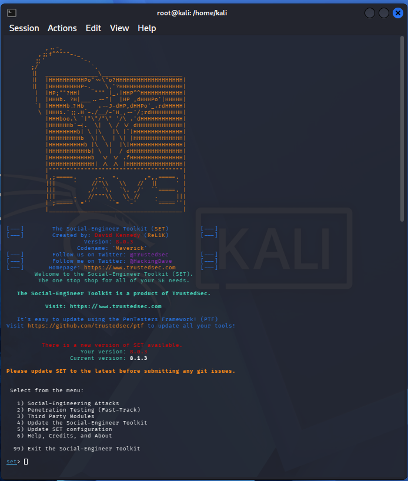

# cibersecurity-desafio-phishing
Estudo prático de engenharia social no bootcamp de Cibersegurança da DIO: reproduzi um ataque de credential harvesting com o SEToolkit (Kali) em laboratório isolado, com foco em entender a técnica para defendê-la. O repo documenta o conceito, o experimento e as contramedidas (blue team).


-----

# 🎣 Phishing com SEToolkit — Estudo de Engenharia Social
 
> Projeto do desafio **DIO — Cibersegurança** | Demonstração e análise de um ataque de *credential harvesting* usando o Social-Engineer Toolkit (SET), em **ambiente de laboratório controlado**, com foco em **entender a técnica para saber defender**.
 


 
---
 
## ⚠️ Aviso legal e ético
 
Este material é **exclusivamente educacional**. Todo o experimento foi executado em **ambiente isolado, em rede local, contra uma conta de teste de minha própria autoria**.
 
- ❌ **Nunca** use estas técnicas contra pessoas, sistemas ou serviços sem **autorização formal e por escrito**.
- ⚖️ No Brasil, capturar credenciais de terceiros configura crime (Lei 12.737/2012 — "Lei Carolina Dieckmann" — e arts. 154-A e 171 do Código Penal).
- 🎯 O objetivo real deste projeto é **compreender o vetor de ataque para construir defesa** (mentalidade *blue team*).
---
 
## 🎯 Objetivo do projeto
 
Reproduzir, em laboratório, um ataque de **phishing por clonagem de página de login** para responder, na prática, a três perguntas:
 
1. Como um atacante monta uma página falsa de forma tão rápida?
2. O que exatamente a vítima vê — e por que ela cai?
3. **Como eu, como defensor, detecto e bloqueio isso?**
---
 
## 🧠 Conceitos envolvidos
 
| Conceito | O que é |
|---|---|
| **Engenharia social** | Manipular o comportamento humano (confiança, urgência, autoridade) em vez de explorar uma falha técnica. |
| **Phishing** | Fazer a vítima entregar dados se passando por um serviço legítimo. |
| **Credential harvesting** | Clonar a tela de login de um serviço real e **registrar** o que a vítima digita. |
| **SEToolkit (SET)** | Framework de engenharia social já incluso no Kali Linux, com menus que automatizam a clonagem e a captura. |
 
---
 
## 🧪 Ambiente do laboratório
 
- **SO:** Kali Linux (máquina virtual)
- **Ferramenta:** Social-Engineer Toolkit (`setoolkit`)
- **Rede:** isolada / apenas `localhost` e LAN do lab
- **Alvo:** conta de teste própria, criada só para o exercício
- **Escopo:** nada foi exposto à internet pública nem enviado a terceiros
---
 
## ⚙️ Como a técnica funciona (visão conceitual)
 
De forma resumida, o SET faz três coisas:
 
1. **Clona** a aparência da página de login legítima (HTML/CSS).
2. **Sobe um servidor local** que entrega essa cópia.
3. **Registra** os campos enviados pelo formulário (o `POST` com usuário/senha) em um log.
Dentro do SET, o caminho percorrido no lab foi:
`Social-Engineering Attacks` → `Website Attack Vectors` → `Credential Harvester Attack Method` → `Site Cloner`.
 
> 📌 O que **não** faz parte deste estudo (e é justamente o que um defensor precisa vigiar): hospedar a página na internet aberta, encurtar/mascarar a URL e distribuir o link para vítimas reais. Isso foi deliberadamente deixado de fora.
 
---
 
## 💻 Comandos utilizados
 
> Executados na VM Kali, em rede isolada. Os passos dentro do SET são **seleções de menu** (digitar o número da opção).
 
**1. Verificar/instalar o SET (já vem no Kali):**
```bash
# Confirmar que está instalado
which setoolkit
 
# Se precisar instalar
sudo apt update && sudo apt install set -y
```
 
**2. Descobrir o IP da máquina do lab (para apontar o alvo de teste a ela):**
```bash
ip addr show        # ou: ifconfig
```
 
**3. Abrir o SEToolkit:**
```bash
sudo setoolkit
```
 
**4. Navegação nos menus (seleções dentro do SET):**
```text
set> 1    # Social-Engineering Attacks
set> 2    # Website Attack Vectors
set> 3    # Credential Harvester Attack Method
set> 2    # Site Cloner
# IP do listener  -> IP da própria VM (passo 2)
# URL a clonar    -> página de login usada no teste
```
 
**5. Acompanhar a captura em ambiente de teste:**
Após logar com a **conta de teste própria** na página servida localmente, o SET exibe os campos recebidos no terminal e grava o relatório em:
```bash
ls -l /root/.set/reports/
```
 
> 🔒 Nada aqui foi exposto à internet nem enviado a terceiros — tudo contra `localhost`/LAN e conta de teste de minha autoria.
 
---
 
## 🖼️ Evidências
 
> Coloque aqui suas capturas de tela na pasta `/images`.
 
```



```
 ---
 


<!-- Dica: borre/ofusque qualquer dado real nas prints antes de subir. -->
 
---
 
## 🛡️ Como se defender (a parte que importa)
 
Este é o diferencial do projeto — mostra pensamento de defensor, não só de atacante.
 
**Para usuários:**
- Desconfie de **urgência** ("sua conta será bloqueada em 24h").
- **Confira a URL** na barra de endereço — domínio e cadeado não garantem legitimidade, mas um domínio estranho entrega o golpe.
- Nunca digite senha a partir de um link recebido; acesse o site **digitando o endereço** você mesmo.
- Ative **MFA/2FA** — mesmo com a senha vazada, o atacante trava no segundo fator.
**Para quem defende sistemas (blue team):**
- **MFA obrigatório** + chaves FIDO2/passkeys (resistentes a phishing).
- Filtros de e-mail com **DMARC, SPF e DKIM** bem configurados.
- **Proteção de marca / detecção de domínios *lookalike*** (typosquatting).
- **Treinamento e simulações** periódicas de phishing para os times.
- Monitoramento de **logs e alertas** de login anômalo (geolocalização, horário, device novo).
---
 
## 📚 Lições aprendidas
 
- A barreira técnica para montar um phishing é **baixíssima** — o que torna educação do usuário e MFA tão críticos.
- O elo mais frágil quase nunca é o software; é o **fator humano**.
- Entender o ataque em laboratório deixa a **defesa muito mais concreta**.
---
 
## 🗂️ Estrutura do repositório
 
```
.
├── README.md
└── images/
    ├── 01-menu-set.png
    ├── 02-pagina-clonada.png
    └── 03-log-captura.png
```
 
---
 
## 🔗 Referências
 
- Documentação do Social-Engineer Toolkit (TrustedSec)
- Kali Linux — ferramentas de engenharia social
- OWASP — Phishing / Social Engineering
- DIO — Formação de Cibersegurança
---
 
**Autor:** Francis Nascimento · [LinkedIn](#) · [GitHub](#)
*Projeto desenvolvido para fins educacionais no bootcamp de Cibersegurança da DIO.*
